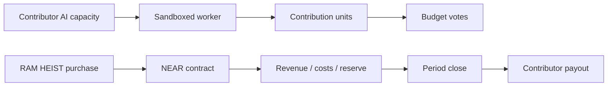
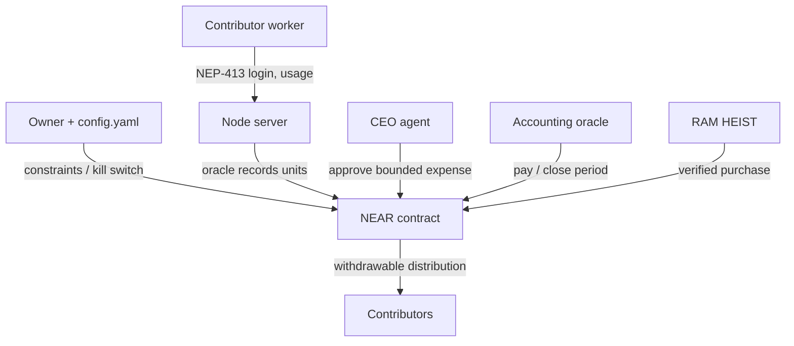

# Foundry Stack / Agent Corp

> What if unused AI-subscription capacity could earn a share of product revenue?

**Foundry Stack** is an autonomous-company demo on NEAR testnet. Contributors lend a capped
slice of the AI plans they already pay for; policy-bound agents turn that capacity into work;
the contract accounts for revenue, costs, reserves, governance, and contributor payouts.

`NEAR testnet` · `autonomous AI company` · `revenue share by contribution` · `hackathon demo`

Everything here is a testnet demo. `config.yaml` rejects networks other than `testnet`.

## Demo

| | |
| --- | --- |
| 🌐 **Landing + live demo** | [f-stack.ai](https://f-stack.ai): pitch, video, embedded game, wallet connect, investor dashboard |
| 🎮 **Game only** | [ram-heist-game.vercel.app/game](https://ram-heist-game.vercel.app/game) |
| 🎬 **Video** | [Agents at work](server/web/foundry-stack-agents-v12.mp4) |
| 🖥️ **Local dashboard** | `http://127.0.0.1:8787/investor` after `pnpm start` |

## The idea in one minute

People pay for AI subscriptions (Claude, Codex, Cursor, …) and use only part of them. That
leftover capacity is wasted every month. Foundry Stack turns it into a small autonomous company:

1. **Contributors** connect an AI plan they already own and set a hard daily cap. Their credentials
   never leave their machine; a sandboxed worker runs the jobs.
2. **The company** (policy-bound CEO and accounting agents) spends that capacity on real work:
   building, marketing and running a product.
3. **Customers** pay for the product in testnet NEAR. The payment is recorded on-chain as revenue.
4. **The contract** subtracts approved costs, keeps a reserve, and splits the net revenue among
   contributors in proportion to the contribution units they supplied.
5. **Humans stay in control.** The owner sets limits and a kill switch in `config.yaml`;
   contributors vote on budgets weighted by contribution units; the CEO agent cannot move money.

The point is not the game. It is a working, auditable loop where idle AI capacity becomes
ownership of a product's revenue.

## Product loop

| | |
| --- | --- |
| 🔌 **Unused AI resources** | Contributors connect an existing AI plan and set a hard cap. |
| 🤖 **Autonomous AI company** | Deterministic CEO and accounting agents operate within owner policy. |
| 🏛️ **Human governance** | Owner sets limits; contributors vote on budgets by contribution units. |
| 💸 **Revenue sharing** | Customer payments become on-chain revenue; net revenue is distributed pro rata. |



The revenue product is **RAM HEIST**, a small browser stealth game: sneak past guards, steal
RAM, get out. A pass and a Smoke Grenade are testnet-NEAR purchases. It proves one loop:

> sale → company revenue → expenses → net split by contribution units

The game is intentionally a small, shippable demo product; another product could replace it.

## Architecture



- **Contract** (`contract/`, Rust / near-sdk): records sales, contribution units, expenses,
  reserves, distribution receipts, contributor withdrawals, and weighted Board budget votes.
  Owner controls constraints and kill switch; CEO cannot move money; oracle has only its scoped
  accounting methods.
- **Server** (`server/`, Node): runs static pages, game API, WebSocket worker protocol, agent
  timer, investor dashboard, and dry-run growth harness. Game runs are replayed server-side.
- **Worker** (`worker/`): macOS-sandboxed CLI for Claude, Codex, OpenCode, Cursor, Pi, or ACP;
  it enforces daily caps and keeps provider credentials contributor-owned.
- **Web**: `/` landing, `/investor` dashboard, `/ledger` ledger, `/game` Three.js game.

## How a sale flows through the system

1. A player opens the landing page, connects a NEAR testnet wallet and plays RAM HEIST.
2. Buying a pass or Smoke Grenade attaches testnet NEAR to a contract call
   (`buy_smoke_grenade` and the pass purchase).
3. The contract records the sale as revenue. The server verifies purchases and replays game runs
   server-side, so scores cannot be forged from the browser.
4. The CEO agent proposes bounded expenses (for example growth or infrastructure vendors); the
   contract enforces owner limits before any expense is approved.
5. At period close the accounting oracle pays approved costs, sets aside the reserve, and
   publishes a distribution. Each contributor withdraws their share pro rata to their units.
6. The investor dashboard shows units, revenue, costs, reserve, votes and payouts.

## Roles and trust

| Role | Can do | Cannot do |
| --- | --- | --- |
| Owner | Set constraints, prices, vendors, kill switch | Rewrite recorded history |
| CEO agent | Request bounded expenses | Move money |
| Accounting oracle | Record units, pay approved costs, close periods | Exceed owner limits |
| Contributor | Lend capped AI capacity, vote, withdraw payout | Read other contributors' credentials |
| Customer | Buy passes and items | Anything outside the purchase flow |

## Quick start

Requirements: Node ≥22.22.2, pnpm 10.11, Rust 1.95 + `cargo-near`; worker/macOS app need macOS.

```bash
pnpm install
pnpm setup:testnet  # fresh testnet accounts, deploy contract, write ignored .keys/
pnpm demo           # units → sale → expense → close → withdrawal
pnpm start          # build web bundles, serve http://127.0.0.1:8787
```

Connect a contributor worker:

```bash
worker/bin/agent-corp-worker providers
worker/bin/agent-corp-worker --account alice.testnet
```

## Main commands

| Command | Purpose |
| --- | --- |
| `pnpm start` | Build web assets and run full server |
| `pnpm build:web` | Bundle wallet and game clients |
| `pnpm constraints` | Push `config.yaml` constraints / kill switch |
| `pnpm demo` | Scripted testnet end-to-end loop |
| `pnpm test` | TypeScript test suites |
| `pnpm test:contract` | Rust contract tests |
| `pnpm typecheck` | TypeScript checks |
| `pnpm growth` | Run standalone, dry-run growth API |

## Configuration and safety

`config.yaml` is owner policy: prices, reserve, period length, expense ceiling, vendors, worker
usage policy, and kill switch. `pnpm constraints` applies it to the contract. Growth is dry-run by
default; use `.env.growth.example` as the environment template.

For a fresh deployment, bundled `contract/res/agent_corp.wasm` and ABI are rebuilt from current
contract source and include `buy_smoke_grenade`.

## Demo boundaries

- Hackathon withdrawals are simulated; token baseline, investor split, and hackathon votes are mock.
- `/api/hackathon/reset` and `/api/hackathon/finalize` are demo endpoints: restrict them before
  any shared/public deployment.
- Worker execution is macOS-only.
- The public deployment uses one shared demo wallet and score; there is no production payment support.

## Deployment topology (public demo)

| Piece | Where | Source |
| --- | --- | --- |
| Landing, embedded game, investor dashboard | Vercel project `foundry-stack-landing`, domain `f-stack.ai` | `landing-site/build.mjs` |
| Game-only site | Vercel project `ram-heist-game` | `game-site/build.mjs` |
| Game backend (`/api/*`) | Hetzner VM behind Caddy, HTTPS, loopback-bound service | `server/src/game-server.ts` |
| Contract | NEAR testnet | `contract/` |

Both Vercel sites are static builds that proxy `/api/*` to the backend, so the browser only talks to
its own origin. The backend allows POSTs only from its game origin plus the origins listed in
`EXTRA_ORIGINS` (the landing site). Build and deploy:

```bash
GAME_BACKEND_ORIGIN=https://<backend-host> node landing-site/build.mjs
cd landing-site/dist && vercel --prod        # f-stack.ai
GAME_BACKEND_ORIGIN=https://<backend-host> node game-site/build.mjs
cd game-site/dist && vercel --prod           # game only
```

Never deploy the repository root or `.keys/`. Backend details, env vars and the one-purchase
safety marker are in [server/GAME-BACKEND.md](server/GAME-BACKEND.md).

## Documentation

| Doc | About |
| --- | --- |
| [CONTEXT.md](CONTEXT.md) | Glossary of project terms |
| [docs/AGENT-CORP.md](docs/AGENT-CORP.md) | Company model |
| [docs/COMPANY-POLICY.md](docs/COMPANY-POLICY.md) | Policy the agents operate under |
| [docs/ARCHITECTURE-REVIEW.md](docs/ARCHITECTURE-REVIEW.md) | Architecture review |
| [docs/GROWTH-HARNESS-PLAN.md](docs/GROWTH-HARNESS-PLAN.md) | Dry-run growth harness |
| [docs/KEYS-SETUP.md](docs/KEYS-SETUP.md) | Testnet key setup |
| [contract/README.md](contract/README.md) | Contract details |

## Repository map

| Path | Contents |
| --- | --- |
| `contract/` | NEAR Rust contract and generated deployable WASM/ABI |
| `server/` | HTTP/WebSocket server, agents, dashboard, landing, game |
| `worker/` | Contributor CLI and provider adapters |
| `shared/` | Protocol, pricing, auth, NEAR helpers |
| `landing-site/` | Static build of the public landing (f-stack.ai) with game and dashboard |
| `game-site/` | Static game-only deployment build |
| `growth/` | Owner-managed growth brief and policy |
| `mac-app/` | SwiftUI worker wrapper |

## License

All rights reserved. See [LICENSE](LICENSE).
