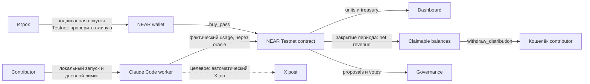

# NEAR Hackathon: визуальный план и аудит демо

Статус: аудит репозитория, 15 ноября 2026. Кадры ниже — план; не считать запланированное работающим до проверки. Все цепочки и суммы — NEAR Testnet, не инвестиции и не equity.

## История треда: 8 изображений

1. **Обложка — игра + компания.** Игровой кадр и короткая фраза «AI builds a game. NEAR coordinates the company.» Подпись: Testnet demo. Нужен чистый кадр игрового процесса, не экран ошибки.
2. **Схема цикла — центральный кадр.** Игрок → NEAR payment → contract treasury → закрытие периода → распределение → вывод; параллельно contributor → Claude worker → проверенный usage → contribution units. На каждом переходе показать, что реально подтверждено, а что планируется.
3. **Игра и оплата.** Два кадра: игровой процесс и подтверждённая покупка с кошельком и ссылкой на транзакцию. Сейчас контракт продаёт Pass, а не Smoke Grenade; отдельную покупку гранаты сначала реализовать. Не показывать shared demo wallet как личный кошелёк.
4. **Подключение ресурсов.** macOS-приложение: провайдер, лимит, статус соединения. Текущий лимит дневной; недельный 100K ещё не реализован. Не выдавать ограничение приложения за настройку или передачу подписки Claude.
5. **Investor Dashboard.** Вклад, общее число units, пропорции, доступные к выводу средства, Testnet account и ссылка на контракт. 253,420 и 40/60 — только явно помеченные mock-данные до их фактической настройки.
6. **Работа агентов.** Доска To Do → In Progress → Done / Failed и ссылка на результат. Для X использовать реальный post URL только после фактической публикации; иначе обозначить как planned или failed.
7. **Доказательство NEAR.** Скриншот обозревателя с contract account, purchase и withdrawal. Использовать настоящие хеши, разные транзакции и Testnet. Предыдущий close не является новой покупкой или выводом.
8. **Governance и призыв попробовать.** Proposal и голоса с указанием mock или on-chain. Добавить проверенные ссылки на игру, репозиторий и контракт. Видео — позже.

Для X подготовить исходники 1600×900, крупный текст и читаемые подписи; не показывать ключи, credential paths или приватные данные. Сначала снять реальные состояния, затем добавить выноски; mockup маркировать «concept».

## Схема: текущая архитектура и целевой сценарий

NEAR здесь — идентичность и подпись кошельком, контрактная казна и покупка, запись единиц вклада, голосование, периодическое распределение и вывод. Расход токенов измеряется вне цепочки; oracle записывает единицы, это не on-chain доказательство работы модели. Текущая модель распределяет **net revenue после закрытия периода**, а не сразу всю выручку после покупки.

## Аудит: real / mock / не проверено

- **Real, ранее проверено:** контракт `contract.agentcorp-c103c2bb.testnet`; в сохранённом отчёте описан полный Testnet demo с двумя contributor-аккаунтами, покупкой pass, расходом, закрытием и двумя выводами. Там же описаны две Claude-сессии с реальным usage. Это историческое свидетельство, а не подтверждение текущего состояния.
- **Код есть, live не проверено:** персональное подключение MyNearWallet и checkout; новая 3D-версия игры; growth-интеграции. Публичная игра согласно README использует общий demo wallet.
- **Есть, но отличается от задания:** contract реализует покупку pass и распределение net revenue после закрытия периода. В macOS-приложении лимит 100,000 токенов **в день**, есть ручные Start worker и Run test; приложение локальное и неподписанное. Дашборд содержит demo controls. Политика growth требует подтверждение X; прямой автоматический X-flow отсутствует или не подтверждён.
- **Требует реализации/проверки:** заданный onboarding, недельный бюджет, автоматический запуск одного X job после подключения, сохранение и идемпотентность, персональные две сессии, smoke grenade, связанный dashboard и reset. Данные 40/60, 253,420 и mock proposal — задания для демо, не подтверждённое текущее состояние.
- **Не путать:** contribution units и revenue share — демонстрационная модель, не выпуск акций. Лимит worker — локальная квота использования, не передача токенов от Claude.

## Проверка агентами без реального кошелька и подписки

1. Unit и integration: mock provider возвращает фиксированный usage и ошибки; fake publisher имитирует успех, timeout и повтор. Проверить один job, статус Failed, retry и отсутствие двойной публикации/начисления после рестарта.
2. Testnet-контракт: отдельные тестовые аккаунты и ограниченный баланс; программно подписывать транзакции выделенными тестовыми ключами, без личного кошелька. Проверить purchase, закрытие периода, claimable, вывод и повтор. Это настоящие Testnet-транзакции, но не проверка UX кошелька.
3. Browser: две изолированные сессии с тестовым wallet adapter для регрессий, refresh и reset. Отдельно человек проходит MyNearWallet и подпись: mock не доказывает настоящий wallet flow.
4. Один ручной smoke test с настоящим Claude и X при готовых подключениях: проверить ответ провайдера, usage, реальный post URL и повторный запуск. Симуляции явно маркировать; неизвестный исход публикации не повторять автоматически без сверки с X.

## Подтверждённые артефакты и ссылки

- Репозиторий из git remote: https://github.com/Agent-Corp-Near-Hackathon-Kastet99/agent-corp
- Публичная игра отвечает HTTP 200: https://ram-heist-game.vercel.app/game. Функциональность полного сценария в этом аудите не подтверждена.
- Контракт и ссылки на deployment/close приведены в [отчёте прошлой проверки](handoffs/LIVE-VERIFICATION.md). Nearblocks при автоматической проверке вернул защитную страницу 403, поэтому заново содержимое транзакций не проверено.
- Локальные черновые скриншоты: `artifacts/hackathon/dashboard-current.png`, `artifacts/hackathon/game-current.png`. Игра на снимке показывает ошибку доступа к demo actions; это не готовый кадр для подачи.
- Landing URL, dashboard URL, company wallet, payment/withdrawal hash, X post, video и submission URL: **не подтверждены в этом аудите**. Не заполнять догадками.
